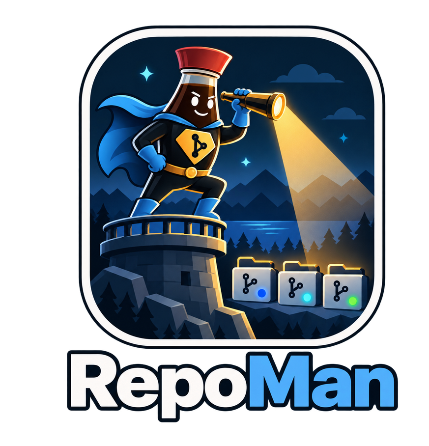
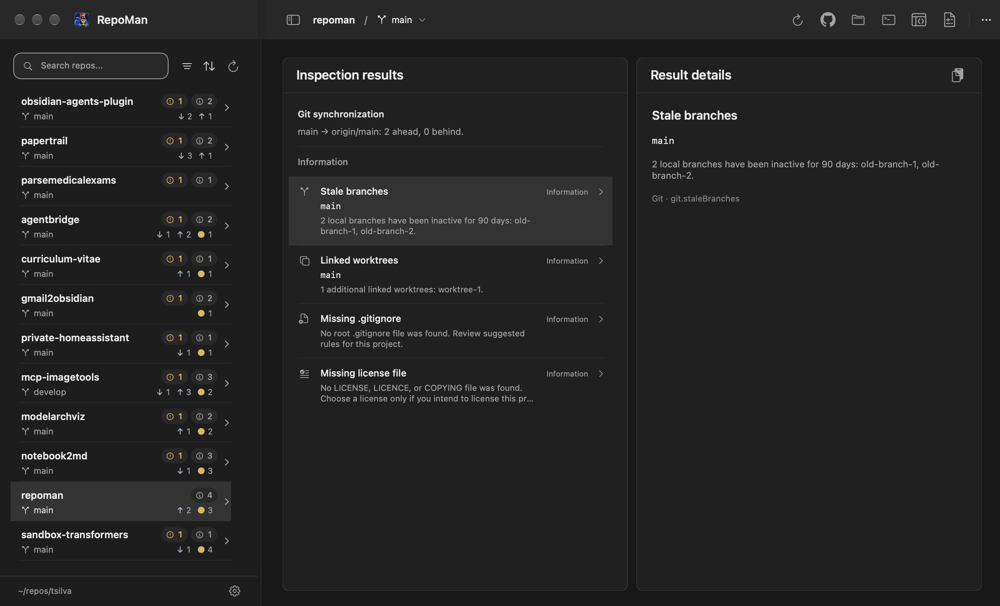
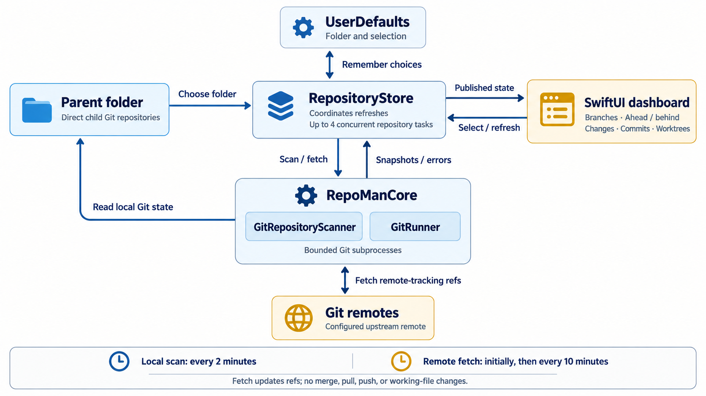

<p align="center">
  
  <br />
  <!-- repo-tagline:start -->
  <strong>🔎 Check your Git repositories and inspect every issue 🧭</strong>
  <!-- repo-tagline:end -->
</p>

<p align="center">
  <a href="https://github.com/tsilva/repoman/blob/main/RepoMan.xcodeproj/project.pbxproj"></a>
</p>

RepoMan is a macOS app for developers managing several local Git repositories. See uncommitted changes, commits to push or pull, stale branches, linked worktrees, missing project files, failing CI, and missing CI coverage in one dashboard. Choose your repositories' parent folder and inspect each finding's evidence. The dashboard and a shared command-line checker report evidence; Codex skills and your own tools handle maintenance.



## Install

Download the Apple Silicon DMG from [GitHub Releases](https://github.com/tsilva/repoman/releases/latest), open it, and drag **RepoMan** to **Applications**. Requires **macOS 27 or later** and Git from the Xcode command line tools. The app is signed ad hoc and is not notarized; macOS may require approval on first launch.

RepoMan checks for a newer stable GitHub release at startup and every six hours. When a compatible DMG and checksum are available, a blue download button appears at the bottom of the sidebar (or in the toolbar when the sidebar is hidden). Click it to download, verify, install, and restart automatically. **RepoMan → Check for Updates…**, **About RepoMan**, and **Settings → General** also provide update controls. Checks use the public GitHub API and need no GitHub login.

The updater verifies the release’s SHA-256 checksum, GitHub asset digest when provided, app identity, version, macOS requirement, and code signature before quitting. Updates are disabled while repository checks are running. The updater replaces the app in its current location. A backup is kept until the replacement launches; installation or launch failures restore the previous version. Install in a writable Applications folder (such as `~/Applications`); apps running from the DMG or macOS App Translocation must be moved first. Development builds and demo mode cannot install updates. Ad-hoc signatures provide integrity checks; update authenticity relies on HTTPS and the repository’s GitHub release assets.

To build from source, install **Xcode 27**:

```bash
git clone https://github.com/tsilva/repoman.git
cd repoman
open RepoMan.xcodeproj
```

In Xcode, select the **RepoMan** scheme and run it on your Mac.

## Use

The RepoMan logo and wordmark sit in the top bar beside the window controls, above the left pane. The sidebar toggle sits above the detail pane; selected-repository Refresh sits alongside Finder, Terminal, editor and diff icons at the top right; search stays at the top of the sidebar.

Click **Choose Folder…** and select the parent folder containing your repositories. Search, filter, or sort to find repositories needing attention. Select a repository to see its flat **Issues** list, ordered by check category and then check. Every finding appears directly, including repeated files or subjects. Select a finding to read its title, full evidence, subject, check ID and category. Available CI and issue links open in your browser. **Copy maintenance task** copies the evidence and a fresh verification command for use in Codex.

Issue rows show current detector results. Incomplete checks remain visibly unknown, separate from confirmed findings. Queued and running checks appear while inspection is in progress; passed checks are hidden. Refresh after fixing something externally to check the result again. The app has no repair presets, selection checkboxes, conversations, agent execution or automatic repair recovery. Earlier conversation files remain on disk but are no longer loaded or resumed.

Git activity appears beneath each repository's issue badges as **↓** commits to pull, **↑** commits to push, and **●** changed files. Zero counts stay hidden. Use your Git tools or the `repo-sync` skill to synchronize repositories; RepoMan does not commit, merge or push.

The folder, terminal and editor toolbar buttons open the selected repository in your own tools. The changes button opens its read-only Git diff. Open **Settings…** from the overflow menu or press **⌘,** to enable or disable checks and change the monitored folder. These preferences do not modify monitored repositories. RepoMan has no model-provider setup or inference calls; use skills such as `optimize-readme` for editorial reviews.

**CI failing** reads GitHub check runs and commit statuses for the latest published default-branch commit and the tracked branch (or matching published local branch). Install the GitHub CLI and sign in with `gh auth login`; RepoMan finds `gh` automatically and uses its existing login. Failed checks include a link to CI details. Pending, cancelled, missing, inaccessible, or incomplete results stay unavailable. Local unpushed changes are not represented by remote CI results.

**Missing CI coverage** inspects local GitHub Actions workflows in code projects for recognizable build, test, lint, or type-check commands on branch pushes or pull requests. Dependency review, manual workflows, and tag-only releases do not satisfy it. Literal false job/step conditions and dependencies on disabled jobs do not count; unevaluated conditions remain unavailable. This is a conservative configuration check, not a measurement of test coverage: custom actions, unrecognized scripts, reusable workflows, unsupported YAML, and external CI configurations may require review and are reported as unavailable.

Service-access checks validate root `.access.toml` and `.access.local.toml` metadata, plus local-file privacy (ignored, untracked, current owner, mode 0600), without contacting a credential provider or printing values. Unsupported TOML forms remain incomplete. **Open Dependabot security alerts** reads GitHub’s published dependency graph using the existing `gh` login, with bounded pagination. Disabled alerts, missing access, incomplete responses and pagination limits remain incomplete; known alerts are retained. This does not assess exploitability or uncommitted dependency changes. The CLI requires `--remote` for this check.

Additional checks cover dependency safeguards, lockfile and runtime consistency, Actions security, unpublished branches and upstream tracking, potential tracked secrets, oversized files, submodule/LFS checkout integrity, leftover merge markers, broken project and documentation references, tracked generated files, old stashes, unfinished Git operations, published description drift, and opt-in notebook hygiene. GitHub repositories whose names start with `private-` (case-insensitive) must have private visibility; public and internal visibility are flagged. The app only reads visibility; change repository settings in GitHub yourself. See [additional checks and per-repository exceptions](docs/additional-checks.md) for `.repoman.json` configuration.

Live website availability, Sentry, Analytics and Cloudflare probes have been retired from RepoMan. Run live-site audits separately; see [website audit migration and domain inventory](docs/website-checks.md).

See [the checker and issue-details architecture](docs/issues.md) for extending the workflow.

## Commands

In Codex, `$repoman_build-release` or `/repoman_build-release` builds, verifies, and publishes a
GitHub Release. Request a local build explicitly to keep the artifacts local.
The shell helper below builds local artifacts without publishing.

```bash
swift test  # run shared checker and Git integration tests
swift run repoman check --repo "$PWD" --check dependencies.safeguards --format json

# Build the app locally
xcodebuild -project RepoMan.xcodeproj -scheme RepoMan \
  -configuration Debug -derivedDataPath DerivedData build

# Show illustrative data for design review
open DerivedData/Build/Products/Debug/RepoMan.app --args --demo

# Check native toolbar alignment while resizing and capture the complete window
bash Tools/verify-window-resizing.sh --screenshot "$PWD/.build/native-window.png"

# Verify update replacement and relaunch using disposable demo app copies
swiftc -parse-as-library RepoManCore/AppUpdate.swift \
  RepoManCore/AppUpdateInstaller.swift Tools/VerifyAppUpdate.swift \
  -o .build/verify-app-update
.build/verify-app-update DerivedData/Build/Products/Debug/RepoMan.app

# Test and package an Apple Silicon DMG with a SHA-256 checksum
bash .codex/skills/repoman_build-release/scripts/build-release.sh
```

## Notes

- Discovery scans visible direct child repositories with a `.git` directory or file. Linked worktrees are excluded from the repository list and shown under their primary repository. Nested folders are not scanned.
- RepoMan remembers your folder, selected repository, filter, sort mode and direction, ignored checks, and disabled checks. Checker results and completion times persist under `~/Library/Application Support/RepoMan/inspection-cache.json`. Legacy `repair-tasks.json` files are left untouched and never read.
- While a repository is being checked, a spinner replaces its issue counter. Each repository returns to its issue count as soon as its check finishes.
- Startup restores valid checker results and runs missing or expired checks. Every minute the scheduler checks for expired results. Choosing a folder checks its repositories; **Refresh** forces checks for the selected repository and **Refresh All** forces all repositories. Fetch updates configured remote-tracking refs without an upstream and may prune deleted remote-tracking branches.
- Refresh fetches remote-tracking refs without merging, pulling, pushing, or changing working files. Git commands have timeouts and disable credential prompts. Failed fetches keep local status visible, but remote counts may be outdated.
- Git counts require a known upstream comparison for push/pull. Routine changes and push/pull counts remain status information rather than actionable issue badges. Stale branches have no commits in 90 days, excluding `main`, `master`, and branches checked out in any worktree. Linked worktrees exclude the primary worktree and appear under Information, separately from actionable issue counts. Coverage limits remain visible as unknown results.
- External Git tools can change a checkout during inspection. Findings are observations, not writer clearance or authorization to publish changes.
- The screenshots and `--demo` mode use illustrative data. Demo mode uses illustrative data and does not inspect real repositories.
- Local packaging writes a DMG and checksum under `dist/`. Pushing a `vX.Y.Z` tag publishes them through the [release workflow](.github/workflows/release.yml). Packaging preserves the signed app's metadata and verifies its signature before creating the DMG and again after mounting it. Packaged builds are signed ad hoc and are not notarized; Gatekeeper may require manual approval.
- RepoMan is distributed under the MIT license.

## Architecture

The diagram shows discovery and refresh. The [checks and issue-details guide](docs/issues.md) explains detection, evidence, scheduling and the shared CLI.



## Shared CLI

Use `$repo-maintenance` from the global `private-skills` collection in Codex for an iterative maintenance pass over selected repositories. The shared skill validates findings, proposes fixes and reruns checks after authorized repairs. The skill assesses checker quality first, repairs confirmed checker problems within the authorized scope, and reruns before recommending repository repairs. Ambiguous policy changes or expanded scope require a user decision. This workflow is maintained in `private-skills`.

The [repository checks workflow](.github/workflows/ci.yml) runs Swift tests, CLI integration tests and an app build on pushes to `main`. It does not publish releases.

Every Xcode app build includes `Contents/Helpers/repoman`. For an app installed in `/Applications`:

```sh
/Applications/RepoMan.app/Contents/Helpers/repoman --list-checks
/Applications/RepoMan.app/Contents/Helpers/repoman check --repo /path/to/repo --format json
```

The CLI uses the same detectors and repository exceptions as the dashboard. Dependency-age exceptions can target individual package settings. It runs fresh checks without reading desktop preferences or writing inspection caches. By default it does not fetch or change Git state. Add `--fetch` to refresh only remote-tracking refs before checking; branches, tags, index and working files remain unchanged. Add `--remote` to permit read-only GitHub checks through your existing `gh` login; otherwise those checks are explicitly skipped. JSON schema version 2 distinguishes `information` from actionable `findings`. Exit codes are 0 when selected checks complete with no actionable findings (informational observations are allowed), 1 when actionable findings exist even with incomplete coverage, 2 for invocation/startup errors, and 3 for incomplete verification without actionable findings. Checks with no supported dependency manifests report `not_applicable` rather than passing. Python lockfile drift checks cover dependency groups, bounded nested includes and platform-marker declarations without running a resolver. Unfetched Git comparisons stay incomplete, with local-ref findings marked provisional. Fetch failures preserve local results. A local pass does not establish remote health. Documentation links into direct sibling Git repositories are checked for existence without opening their contents; other escapes remain incomplete without discarding known broken links. See [the report contract and skill integration](docs/issues.md#shared-cli).

## License

[MIT License](LICENSE).
